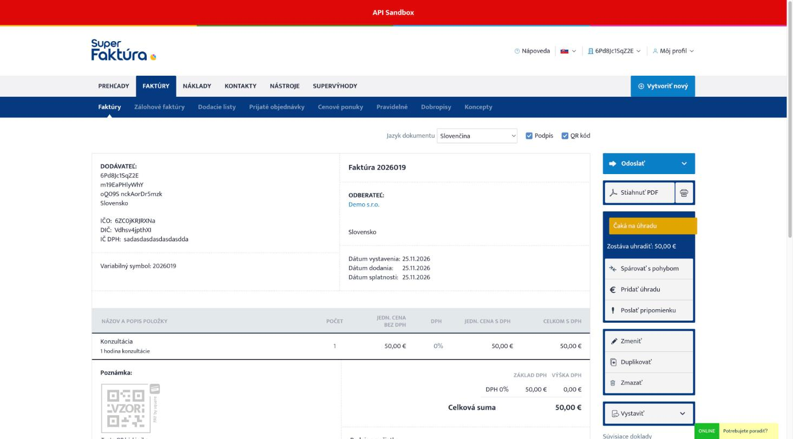

# superfaktura-mcp v0.1.0: tools aligned with the SuperFaktura docs, uvx package, tests, registry files

> [!IMPORTANT]
> 6 of 19 tools called the API wrong (wrong URL, method or body). All 6 are fixed, and 2 lookup tools were added (21 tools now). The pre-release review fixes (C1-C9, P1-P5) are in too. The worst was C1: text from the model could turn a PDF call into a GET delete. Everything was re-run against sandbox.superfaktura.sk: 51 passed, 1 skipped (send_invoice, which sends a real email). Claude ran the 9-step scenario through the MCP again with no failures. Publishing waits for `OSS5ca`.

## Decide
### Needs you
- **OSS5c · Publish to PyPI and the MCP Registry**
  - Why: a publish is public and one-way, so it is yours to run.
  - Goes out: PyPI `superfaktura-mcp` 0.1.0 and registry.modelcontextprotocol.io `io.github.Digitaliko/superfaktura-mcp`, public
  - Answer: `OSS5ca` publish 0.1.0 now (the sandbox run is green) / `OSS5cb` wait -> `OSS5ca`

### FYI
- **OSS5d · Demo data stays in the sandbox** Client "Demo s.r.o." (id 104114) and invoice 2026019 "MCP demo (test data)" are kept for you to look at. The suites and the scenario run deleted all their own test data.
- **OSS5 · Recurring invoices are not in the public API** The docs show only a `recurring` field on invoices, with no endpoint to list, edit or create recurring invoices.

## What happened
- Every tool's URL, method and body checked against the SuperFaktura docs (https://github.com/superfaktura/docs). 6 tools did not match. They are fixed and each has a mocked test.
- `uvx superfaktura-mcp` works: added a console script and PyPI metadata, removed the unused `jsonpath-ng`, and `requirements.txt` now matches `pyproject.toml` (a test checks it).
- Tests: a mocked HTTP case per tool, plus timeout, HTTP 429, missing credentials and the SK/CZ/AT/sandbox URL switch. A stdio smoke test starts the server and lists its 21 tools. `tests/test_sandbox.py` (every tool end to end, runs only with `SANDBOX_SUPERFAKTURA_*` and refuses any non-sandbox URL). CI runs them on Python 3.10 and 3.12, then builds the wheel and starts it with uvx.
- Sandbox scenarios (`tests/test_sandbox_scenarios.py`, 30 cases, some taken from the SlovenskaZnamka SuperFaktura tests): clients (create with IČO, DIČ and address; get; search by name and by IČO; update address and email; paging), invoices (VAT 23 % with several items and a 10 % discount checked to the cent; VAT 0; CZK; list by date and status; exact-number lookup; edit an item; partial then full payment with status 2 -> 3; proforma; credit note; repeat the last invoice; PDF in default, slo and eng), expenses (categories, tags, create, list), and validation. The test data is deleted at the end.
- Validation (the server never raised): an unknown client id gives "Klient nepatrí pod túto firmu.", empty items give "Dokument musí obsahovať aspoň jednu položku", currency XXX gives "Incorrect currency", an unknown invoice gives a 404 error result, and an empty client name is now refused locally (SuperFaktura returned an empty error list). SuperFaktura silently accepts a negative expense and an invalid IČO (it stores the IČO empty). That is how the API behaves, not something the server breaks.
- Sandbox, every tool: passed (19 passed, 1 skipped). As a user test, `claude -p` (sonnet) got the MCP over stdio with the prompt "Vytvor faktúru pre testovacieho klienta Demo s.r.o. na 1 hodinu konzultácie za 50 EUR a potom mi ju vypíš". It searched the clients, created Demo s.r.o., created invoice 2026019 (50 EUR) and listed it back.
- Registry: `server.json` (validated against the 2025-12-11 schema), with an `mcp-name:` line in the README. README also gained badges (PyPI, license, Glama score and card; a CI badge can follow once the workflow is on main) and uvx / Claude Code install steps.
- Small gaps fixed here: `list_expense_categories`, `list_tags`, and the `list_invoices` status values (1 issued, 2 partially paid, 3 paid, 99 overdue). Bigger gaps went to repo issue `superfaktura-mcp#6` (Inbox): eInvoice/Peppol, missing invoice and expense endpoints, value lists, and the PDF tool in hosted mode.

- Review fixes:
  - C1: every `key:value` URL segment is percent-encoded, and languages are checked against the 14 documented codes. An invoice number with `/` goes through search, because on the sandbox the path filter never matched it.
  - C2: `search` takes plain text and is encoded as base64 with `-_,`. Tested with "Košická Žilina".
  - C3 and C8: no HTTP mode. `--http` exits 2 and PORT is ignored. The dead per-request credential path and the "Multi-tenant" claim are removed. The Dockerfile now runs stdio.
  - C4: `mark_invoice_paid` takes `payment_type` and `currency`, and the currency defaults to the invoice's. The documented `date` field did not set the payment date on the sandbox; `created` did, so both are sent (sandbox test: stored 2026-11-20).
  - C5: `.env` is read only in `main()`.
  - C6: the PDF goes to a `mkstemp` file with mode 0600, named by invoice and language.
  - C7: HTTP errors carry the status, 500 characters of the body and `X-RateLimit-Message`; a 429 is retried twice.
  - C9: the sandbox guard checks the exact host.
  - P1: annotations on all 21 tools, `SUPERFAKTURA_READ_ONLY=1`, delete descriptions start with PERMANENT, delete_invoice points to the credit note, and send_invoice needs `email`.
  - P2: unit_price is without VAT and tax is the VAT percent.
  - P3: uv install steps and the `which uvx` path.
  - P4: only SK is tested; CZ and AT use the documented URLs, untested.
  - P5: the credentials error is one line, and the country code is case-insensitive.

## Change
| repo | file | what |
|---|---|---|
| Digitaliko/superfaktura-mcp | `server.py` | send_invoice body `{"Email": {invoice_id, to}}`, PDF via token + file, set_invoice_language GET `lang:`, payments `ajax:1/api:1`, deletes as GET, country default, `main()` |
| | `pyproject.toml`, `requirements.txt`, `uv.lock` | uvx script, metadata, deps in sync, no jsonpath-ng |
| | `tests/` | mocked tools and error paths, stdio smoke, sandbox suite, sandbox scenarios, packaging checks |
| | `.github/workflows/ci.yml` | CI |
| | `server.json`, `README.md`, `CHANGELOG.md`, `docs/API.md` | registry entry, badges, install, 0.1.0 notes |

## Goes out
| token | channel | audience | item |
|---|---|---|---|
| OSS5c | PyPI + MCP Registry | public | package 0.1.0 and the registry entry (Filip runs it) |

Merging deploys nothing. The tag and GitHub release only publish the source.

## Proof
- Red, before the fix (`04b812e`, tests only): `9 failed, 17 passed`. Failing: delete_invoice, mark_invoice_paid, get_invoice_pdf, set_invoice_language, delete_expense endpoints, the send_invoice body (x2), the PDF file, and the country default.
- Green, after (mocked): `29 passed, 20 skipped` (20 skipped = the sandbox suite without keys).
- Review fixes, red first (`303b8cc`, tests only): 38 failing or erroring in `tests/test_hardening.py`. After the fixes they pass.
- Mocked, final: `82 passed, 52 skipped` (the 52 skipped are the two sandbox suites, which need keys).
- Sandbox, final: `tests/test_sandbox.py tests/test_sandbox_scenarios.py`: `51 passed, 1 skipped in 42.24s` (skipped: send_invoice).
- Scenario run through the MCP after the fixes: `claude -p` (sonnet) over stdio, 9 Slovak steps, 17 tool calls, no failure: `mcp-scenario-run.txt`.
  - It created "Košická Žilina s.r.o." and found it with the plain-text search "Košická Žilina".
  - It issued an invoice: 361.00 base + 83.03 VAT = 444.03, which is correct for 380 EUR less 5 % at 23 %.
  - It recorded a 100 EUR cash payment dated 20. 11. (344.03 left), then a proforma, a copy of the last invoice, a private English PDF and an expense.
  - The XXX currency was refused with a readable error.
  - It deleted everything it created.
- Demo, tool calls in order: `list_clients(search "Demo s.r.o.")` -> none, `list_clients(search "Demo")` -> none, `create_client("Demo s.r.o.")` -> id 104114, `create_invoice(client 104114, "Konzultácia" 1 x 50 EUR)` -> id 381212, number 2026019.
- Image: `01-demo-invoice-sandbox-after.jpg` (invoice 2026019 in the sandbox UI; the supplier fields are sandbox placeholders)

- CI builds the wheel, runs it with uvx and lists its tools over stdio.
- `server.json` validates against `https://static.modelcontextprotocol.io/schemas/2025-12-11/server.schema.json`.

## Details

Per tool: mocked / sandbox

| tool | mocked | sandbox |
|---|---|---|
| create_invoice, list_invoices, get_invoice, edit_invoice | pass | works |
| "repeat last invoice" (get_invoice items -> create_invoice) | pass | works |
| send_invoice | fixed (body was `Invoice`, API wants `Email`) | not run: it sends a real email, set `SANDBOX_SUPERFAKTURA_SEND_TO` to run it |
| mark_invoice_paid | fixed (URL) | works |
| get_invoice_pdf | fixed (token missing, PDF parsed as JSON) | works (real `%PDF` file) |
| set_invoice_language | fixed (GET `lang:`) | works |
| delete_invoice, delete_expense | fixed (GET, not DELETE) | works |
| create/list/get/update/delete client | pass | works (`clients/view/{id}.json` is accepted) |
| create/list/get/edit expense | pass | works |
| list_expense_categories, list_tags (new) | pass | works |

Integration readiness (for a superfaktura.sk/integracia and .cz/integrace listing)

- Works today (proven on sandbox.superfaktura.sk, 25. 11. 2026): invoices (create, list with 25+ filters, detail, edit, send, pay, PDF, language, delete), clients (CRUD), expenses (CRUD with attachments). SK, CZ, AT and both sandboxes.
- Install: one line in Claude Desktop or Claude Code (`uvx superfaktura-mcp`), open source (Apache-2.0), listed on Glama.
- Demo prompts for the sandbox:
  1. "Create a client ACME s.r.o., Bratislava, email billing@acme.example"
  2. "Issue an invoice to ACME for web design 500 EUR and hosting 50 EUR, due in 14 days"
  3. "Show unpaid invoices from this month over 100 EUR"
  4. "Mark invoice <n> paid today and give me its PDF"
  5. "Record an expense: office supplies 150 EUR yesterday"
- Demo shown: a Slovak prompt in Claude created client Demo s.r.o. and invoice 2026019 (screenshot above). Still to make for the listing: a 30 s screen recording of prompts 2 to 4 in Claude Desktop.
- Missing, worth saying openly: recurring invoices (not in the API), eInvoice/Peppol (new in the docs), value lists.

